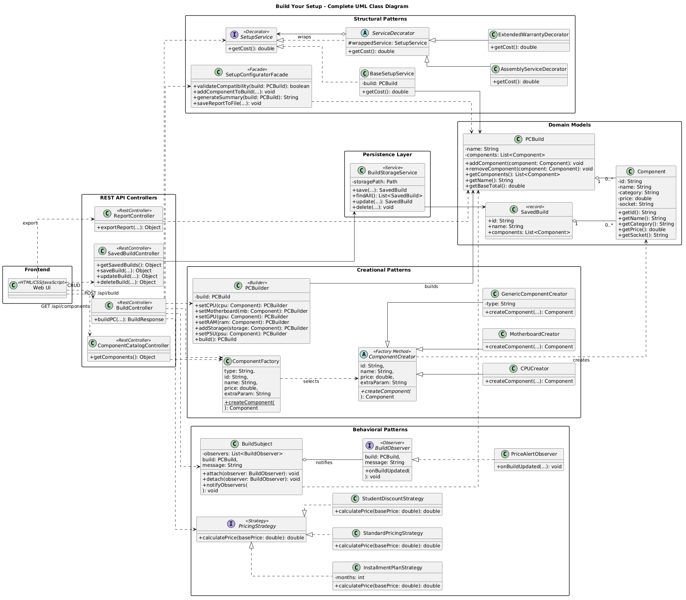
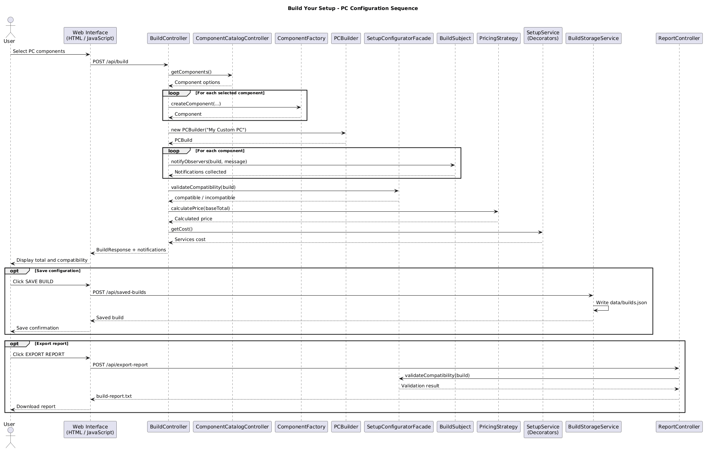

# Build Your Setup

## Software Design Patterns — Final Project

**Project Name:** Build Your Setup  
**Technology:** Java 25, Spring Boot 3.5.7, HTML, CSS, JavaScript  
**Build Tool:** Maven  
**Testing:** JUnit 5  
**Architecture:** REST API + Web Frontend

---

## 1. Project Overview

Build Your Setup is a web-based PC configuration application developed using Java and Spring Boot.

The application allows users to select computer components, validate compatibility, calculate prices, apply different pricing strategies, add optional services, and manage saved PC configurations.

The project demonstrates the practical application of software design patterns in a real-world system.

## 2. Main Features

- Interactive PC configuration interface
- CPU, GPU, motherboard, RAM, and storage selection
- Automatic price calculation
- CPU and motherboard socket compatibility validation
- Student discount pricing
- Installment plans for 6 and 12 months
- Optional PC assembly service
- Extended warranty service
- Build update notifications
- Save PC configurations
- Load saved configurations
- Update existing configurations
- Delete saved configurations
- Persistent JSON storage
- Export configuration reports as TXT files
- REST API integration
- Automated unit testing

## 3. Design Patterns

The project implements six design pattern approaches.

### 3.1 Builder Pattern (Creational)

**Classes:**
- PCBuilder
- PCBuild
- Component

The Builder Pattern constructs a PC configuration step by step.

It separates the construction process from the final PCBuild object.


### 3.2 Factory Method Pattern (Creational)

**Classes:**
- ComponentCreator
- CPUCreator
- MotherboardCreator
- GenericComponentCreator
- ComponentFactory
- Component

The Factory Method Pattern provides an abstract method for creating PC components.

ComponentCreator defines the factory method, while CPUCreator, MotherboardCreator, and GenericComponentCreator implement component creation.

ComponentFactory selects the appropriate creator based on the component category.

This pattern separates object creation from the main application logic and makes it easier to introduce new component types without changing existing business logic.

### 3.3 Facade Pattern (Structural)

**Class:**
- SetupConfiguratorFacade

The Facade Pattern provides a simplified interface for configuration-related operations.

It handles component compatibility validation and provides methods for generating configuration summaries.

### 3.4 Strategy Pattern (Behavioral)

**Classes:**
- PricingStrategy
- StandardPricingStrategy
- StudentDiscountStrategy
- InstallmentPlanStrategy

The Strategy Pattern supports interchangeable pricing algorithms.

Available pricing options include:
- Standard pricing
- Student discount (-10%)
- Six-month installment plan (+5%)
- Twelve-month installment plan (+12%)

### 3.5 Decorator Pattern (Structural)

**Classes:**
- SetupService
- BaseSetupService
- ServiceDecorator
- AssemblyServiceDecorator
- ExtendedWarrantyDecorator

The Decorator Pattern dynamically adds optional services to a PC configuration.

Available services:
- Professional PC Assembly: $29.99
- Extended Warranty: $49.99

### 3.6 Observer Pattern (Behavioral)

**Classes:**
- BuildObserver
- BuildSubject
- PriceAlertObserver

The Observer Pattern provides event-driven notifications when a PC configuration is updated.

Notifications include selected components, pricing alerts, and configuration changes.

## 4. System Architecture

The application follows a layered architecture.

### Frontend

HTML, CSS, and JavaScript provide an interactive user interface.

The frontend communicates with the backend through REST API requests using Fetch API.

### Backend

Spring Boot controllers process requests, construct configurations, calculate prices, validate compatibility, and generate reports.

### Persistence

BuildStorageService stores saved configurations in a JSON file.

Storage location:

`data/builds.json`

Saved configurations remain available after application restarts when the same working directory is used.

## 5. REST API Endpoints

| Method | Endpoint | Description |
|--------|----------|-------------|
| GET | /api/status | Check backend status |
| GET | /api/components | Retrieve component catalog |
| POST | /api/build | Calculate PC configuration |
| GET | /api/saved-builds | Retrieve saved configurations |
| POST | /api/saved-builds | Save a new configuration |
| PUT | /api/saved-builds/{id} | Update an existing configuration |
| DELETE | /api/saved-builds/{id} | Delete a saved configuration |
| POST | /api/export-report | Export configuration report |

## 6. Project Structure

```text
finalsdp/
├── src/
│   ├── main/
│   │   ├── java/com/setupbuilder/
│   │   │   ├── SetupBuilderApplication.java
│   │   │   ├── Component.java
│   │   │   ├── ComponentCreator.java
│   │   │   ├── CPUCreator.java
│   │   │   ├── MotherboardCreator.java
│   │   │   ├── GenericComponentCreator.java
│   │   │   ├── ComponentFactory.java
│   │   │   ├── ComponentCatalogController.java
│   │   │   ├── PCBuild.java
│   │   │   ├── PCBuilder.java
│   │   │   ├── PricingStrategy.java
│   │   │   ├── SetupService.java
│   │   │   ├── BuildObserver.java
│   │   │   ├── SetupConfiguratorFacade.java
│   │   │   ├── BuildController.java
│   │   │   ├── BuildStorageService.java
│   │   │   ├── SavedBuildController.java
│   │   │   └── ReportController.java
│   │   └── resources/static/
│   │       ├── index.html
│   │       ├── style.css
│   │       └── script.js
│   └── test/java/com/setupbuilder/
│       ├── BuildPatternsTest.java
│       └── BuildStorageTest.java
├── docs/
│   ├── class-diagram.png
│   └── sequence-diagram.png
├── pom.xml
└── README.md
```

## 7. Installation and Running

### Requirements

- Java JDK 25
- IntelliJ IDEA
- Maven
- Web browser

### Steps

1. Clone the repository.
2. Open the project in IntelliJ IDEA.
3. Load Maven dependencies.
4. Run `SetupBuilderApplication.java`.
5. Open the browser and navigate to:

http://localhost:8080/


## 8. Automated Testing

The project contains 17 JUnit 5 tests.

### Design Pattern Tests (13)

- Builder construction
- Component creation
- Factory Method component creation
- Standard pricing
- Student discount
- Six-month installment calculation
- Twelve-month installment calculation
- Assembly service decoration
- Multiple service decoration
- Compatible component validation
- Incompatible component validation
- Observer notifications
- Observer detachment

### Persistence Tests (4)

- Save configuration
- Load configuration after service recreation
- Update configuration
- Delete configuration

All 17 tests passed successfully during development.

## 9. UML Diagrams

### Class Diagram



### Sequence Diagram



## 10. Example User Scenarios

1. A user selects compatible PC components and calculates the total price.
2. A student applies a 10% discount to the selected configuration.
3. A customer chooses an installment plan and additional services.
4. A user saves a PC configuration and loads it after restarting the application.
5. A user updates or deletes a previously saved configuration.
6. A user exports a detailed PC configuration report.

## 11. Technologies Used

- Java 25
- Spring Boot 3.5.7
- Maven
- HTML5
- CSS3
- JavaScript
- REST API
- Jackson JSON
- JUnit 5
- PlantUML

## 12. Conclusion

Build Your Setup demonstrates the use of software design patterns in a practical web application.

The project combines object-oriented design, backend development, frontend integration, persistent storage, automated testing, and report generation.

The implementation emphasizes modularity, maintainability, and extensibility.
